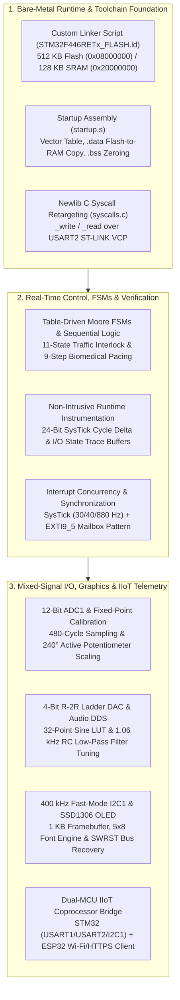

# STM32F446RE Dual-Stack Embedded Systems Suite (Bare-Metal & HAL)

A comprehensive embedded systems engineering suite implemented on the **STMicroelectronics STM32F446RE (ARM Cortex-M4)** microcontroller. Originally adapted from the *Embedded Systems: Shape The World* curriculum (TI TM4C123GH6PM / 80 MHz / Keil µVision), this repository re-engineers all 13 modules for the **STM32 Nucleo-64** platform (16 MHz HSI) using the **GNU ARM Embedded Toolchain (`arm-none-eabi-gcc`)** and **STM32CubeIDE**.

Every module is implemented across **two parallel software architectures**:
1. **`RAW/` (Bare-Metal Register Level)**: Zero vendor libraries (no STM32 HAL, no CMSIS headers). Built from scratch with custom GNU linker scripts (`.ld`), Cortex-M4 Thumb-2 startup assembly (`startup.s`), Newlib C runtime syscall retargeting (`syscalls.c`), and direct memory-mapped register manipulation based on the **STM32F446xx Reference Manual (RM0390)** and **ARM Cortex-M4 Programming Manual (PM0214)**.
2. **`HAL/` (STM32Cube Hardware Abstraction Layer)**: Production-style firmware configured via STM32CubeMX (`.ioc`), separating high-level application and control logic from hardware peripheral drivers.

---

## System Architecture



---

## Key Technical Highlights

### 1. Bare-Metal Bootstrapping & Linker Engineering
* **Memory Layout (`STM32F446RETx_FLASH.ld`)**: Explicitly maps `.isr_vector`, `.text`, and `.rodata` into internal Flash (`0x08000000`, 512 KB), allocates `.data` in SRAM (`0x20000000`, 128 KB) with load address in Flash (`>RAM AT>FLASH`), defines `.bss`, sets the initial stack pointer (`_estack = 0x20020000`), and strips unused standard library archives (`libc.a`, `libm.a`, `libgcc.a`).
* **Startup Routine (`startup.s`)**: Handwritten ARM Thumb-2 assembly defining `g_pfnVectors` and `Reset_Handler`, which initializes `sp`, copies initialized globals from `_sidata` to `_sdata.._edata`, zeros `.bss` (`_sbss.._ebss`), and branches to `main()`.
* **Standard I/O Retargeting (`syscalls.c`)**: Implements `_write()`, `_read()`, `_fstat()`, `_isatty()`, and `_lseek()` hooks for GNU Newlib to route `printf()` and `scanf()` over `USART2` (`PA2` TX / `PA3` RX, `AF7`) via the on-board ST-LINK Virtual COM Port at 115,200 baud.

### 2. Deterministic State Machines & Atomic GPIO Manipulation
* **Table-Driven Moore FSM (`Lab10_TrafficLight`)**: Implements an 11-state traffic intersection and pedestrian crossing controller driven by 3 sensor inputs (`PA6`, `PA10`, `PB3`) and 8 LED outputs distributed across `GPIOA`, `GPIOB`, and `GPIOC`.
* **Glitch-Free Multi-Pin Output**: Constructs 32-bit Bit Set/Reset Register (`BSRR`) words (`bits[15:0]` for set, `bits[31:16]` for reset) and masked 32-bit `ODR` writes so multi-bit output transitions execute atomically in a single bus cycle without intermediate pin states.

### 3. Mixed-Signal Engineering: R-2R DAC, Acoustic Filtering & Fixed-Point ADC
* **Pin Multiplexing & SWO/I2C Conflict Resolution (`Lab13_DAC` & `Lab15_SpaceInvaders`)**: On the Nucleo-F446RE, `PB3` is hardwired to the ST-LINK `SYS_JTDO-SWO` debug trace line, and `PB6` is required for `I2C1_SCL`. The 4-bit R-2R resistor ladder ($13\times 10\text{ k}\Omega$ resistors; $R = 10\text{ k}\Omega$, $2R = 20\text{ k}\Omega$) is mapped to non-consecutive pins (`PB0, PB4, PB5, PB6` in Lab 13; `PB0, PB1, PB2, PB4` in Lab 15) and updated via atomic bit-scattered writes to `GPIOB->ODR`.
* **RC Low-Pass Acoustic Modeling (`Lab15_SpaceInvaders`)**: The $10\text{ k}\Omega$ Thevenin output impedance of the R-2R ladder and the $15\text{ nF}$ capacitance of the `FGT-15T-6.0A1W40` piezo transducer form a first-order RC low-pass filter:
  $$f_{\text{cutoff}} = \frac{1}{2\pi R C} = \frac{1}{2\pi \times 10{,}000\,\Omega \times 15 \times 10^{-9}\,\text{F}} \approx 1{,}061\text{ Hz}$$
  Audio synthesis routines step through a 32-point 4-bit sine wave lookup table (`sin_wave32[32]`) and sweep frequencies within the $280\text{ Hz}–780\text{ Hz}$ passband for maximum $3\text{ V}_{\text{p-p}}$ output swing.
* **Potentiometer Dead-Zone Calibration (`Lab14_Measurement`)**: Calibrates a 12-bit `ADC1` channel (`PA0`, 480-cycle sampling time) against the $240^\circ$ active electrical travel of a $270^\circ$ rotary potentiometer using FPU-free fixed-point integer math (`angle_tenths = (sample * 2400) / 4095`), achieving $0.1^\circ$ resolution without floating-point overhead.

### 4. Fault-Tolerant $400\text{ kHz}$ $I^2C$ Display Driver & Runtime Trace
* **Bare-Metal $I^2C1$ Master (`Lab14_Measurement/RAW/i2c.c`)**: Configures `PB6` (`SCL`) and `PB7` (`SDA`) in open-drain `AF4` mode at $400\text{ kHz}$ Fast Mode (`CCR = 14` $\rightarrow 380.95\text{ kHz}$, `TRISE = 6` at $f_{\text{PCLK1}} = 16\text{ MHz}$). Includes a hardware timeout monitor and an automatic software reset routine (`i2c1_recover()` via `I2C_CR1_SWRST`) to recover from bus lockups (`I2C_SR2_BUSY`).
* **Non-Intrusive State & Timing Trace (`Lab09_FunctionalDebugging`)**: Uses the 24-bit `SysTick` down-counter (`0xE000E010`) in free-running mode to record bit-packed I/O state snapshots (`Data[50]`) and elapsed CPU cycle deltas (`Time[50]`) into SRAM strictly on state transitions.

### 5. Dual-MCU IIoT Weather Station (`Lab16_IoT`)
* **Hardware Partitioning**: Pairs the **STM32F446RE** (real-time controller driving the `SSD1306` OLED over `I2C1`, user button `PC13`, status LED `PA5`, and PC serial console over `USART2`) with a **NodeMCU ESP32** Wi-Fi/HTTPS coprocessor over `USART1` (`PA9` TX / `PA10` RX @ 115,200 baud).
* **Custom UART Bridge Protocol**: Implements a deterministic line-oriented ASCII command/response protocol (`PING` $\rightarrow$ `PONG`, `CONNECT:<ssid>,<pass>` $\rightarrow$ `WIFI:CONNECTED,<ip>`, `WEATHER:<city>` $\rightarrow$ `WEATHER:OK,<city>,<temp>,<condition>`) with timeout and retry management to fetch live JSON telemetry from the **OpenWeatherMap One Call 4.0 API**.

---

## Cross-Platform Hardware Migration Summary

| Subsystem | Original Target (TI TM4C123GH6PM) | Ported Target (STM32F446RE Nucleo-64) |
| :--- | :--- | :--- |
| **Core & Clock** | ARM Cortex-M4 @ 80 MHz (PLL via `TExaS_Init`) | ARM Cortex-M4 @ 16 MHz (Internal HSI RC Oscillator, `PLL = OFF`) |
| **Memory Map** | 256 KB Flash (`0x00000000`), 32 KB SRAM (`0x20000000`) | 512 KB Flash (`0x08000000`), 128 KB SRAM (`0x20000000`) |
| **Clock Gating** | `SYSCTL_RCGC2_R` / `SYSCTL_RCGCGPIO_R` | `RCC_AHB1ENR` (`GPIOA/B/C`), `RCC_APB1ENR` (`USART2`, `I2C1`), `RCC_APB2ENR` (`ADC1`, `USART1`, `SYSCFG`) |
| **On-Board I/O** | RGB LED (`PF1–PF3`), 2 Buttons (`PF0`, `PF4`) | Green LED `LD2` (`PA5`), User Button `B1` (`PC13`, active-LOW with external $4.7\text{ k}\Omega$ pull-up) |
| **Serial Console** | `UART0` (`PA0`/`PA1`) @ 115,200 baud | `USART2` (`PA2`/`PA3`, `AF7`) via ST-LINK VCP @ 115,200 baud (`BRR = 0x008B`, $0.08\%$ error) |
| **Analog Input** | `ADC0` SS3 (`PE2`/`AIN1`), linear slide pot ($0–2\text{ cm}$) | `ADC1` CH0 (`PA0`/`AIN0`), rotary trimmer pot ($0^\circ–240^\circ$ electrical range, 480-cycle sample) |
| **DAC Audio** | 4-bit R-2R ladder on `PB0–PB3` | 4-bit R-2R ladder on `PB0, PB4, PB5, PB6` (Lab 13) or `PB0, PB1, PB2, PB4` (Lab 15) |
| **Display** | Nokia 5110 ($84\times 48$ SPI LCD) | SSD1306 ($128\times 64$ $I^2C1$ OLED @ 400 kHz Fast Mode on `PB6`/`PB7`) |
| **IoT Radio** | TI CC3100 SimpleLink Wi-Fi BoosterPack (SPI) | NodeMCU ESP32 Coprocessor over `USART1` (`PA9`/`PA10` @ 115,200 baud) |

---

## Repository Directory & Module Guide

| Directory | Module Topic | Key Peripherals & Engineering Concepts | Architectures |
| :--- | :--- | :--- | :---: |
| [`Lab02_HelloLaunchPad`](./Lab02_HelloLaunchPad) | Bare-Metal Bring-Up & GPIO | Custom linker script, `Reset_Handler` assembly, `RCC_AHB1ENR`, `GPIOA`/`GPIOC` input-modulated LED blink patterns. | `RAW` / `HAL` |
| [`Lab04_IO`](./Lab04_IO) | Multi-Switch Digital I/O | Interfacing on-board (`PC13`, external pull-up) and external (`PC12`, internal `PUPDR` pull-up) switches; 4-state blink encoding. | `RAW` / `HAL` |
| [`Lab05_FunctionsInC`](./Lab05_FunctionsInC) | Modular C & `USART2` `stdio` | Bare-metal `USART2` driver (`BRR = 0x8B`) and GNU Newlib `_write`/`_read` syscall retargeting for interactive `printf`/`scanf`. | `RAW` / `HAL` |
| [`Lab06_BranchingFunctionsDelays`](./Lab06_BranchingFunctionsDelays) | Calibrated Delays & Probing | Instruction-calibrated software delay loops at 16 MHz HSI and global state observation (`input`, `output`). | `RAW` / `HAL` |
| [`Lab07_HeartBlock`](./Lab07_HeartBlock) | Pacemaker Control Sequence | 9-step sequential biomedical state control (`AS` input on `PC13`, `Ready` on `PA5`, `VT` on `PA6`), 10 ms debounce, 250 ms A-V delay. | `RAW` / `HAL` |
| [`Lab08_SwitchLEDinterface`](./Lab08_SwitchLEDinterface) | Positive-Logic Interfacing | External active-HIGH switch with internal pull-down (`PUPDR = 10` on `PC12`) and $330\,\Omega$ current-limited external LED (`PA6`). | `RAW` / `HAL` |
| [`Lab09_FunctionalDebugging`](./Lab09_FunctionalDebugging) | Non-Intrusive Runtime Trace | 24-bit free-running `SysTick` timer capturing bit-packed I/O changes (`Data[50]`) and cycle deltas (`Time[50]`) in SRAM. | `RAW` / `HAL` |
| [`Lab10_TrafficLight`](./Lab10_TrafficLight) | Table-Driven Moore FSM | 11-state Moore FSM (`State_t FSM[11]`), 3 road/pedestrian sensors, 8 LED outputs across 3 GPIO ports using atomic `BSRR` writes. | `RAW` / `HAL` |
| [`Lab11_UART`](./Lab11_UART) | Serial Driver & Fixed-Point I/O | Blocking/non-blocking `USART2` primitives, ASCII decimal parser (`UART_InUDec`), and fixed-point distance formatter (`"X.XXX cm"`). | `RAW` |
| [`Lab12_TuningFork`](./Lab12_TuningFork) | Audio ISR & Edge-Detect FSM | `SysTick_Handler` at 880 Hz (`RELOAD = 18181`) generating a 440 Hz square wave (`PA6`) controlled by a 4-state button edge FSM (`PC13`). | `RAW` / `HAL` |
| [`Lab13_DAC`](./Lab13_DAC) | 4-Bit R-2R DAC Piano | 4-bit R-2R resistor ladder (`PB0, PB4, PB5, PB6`), 32-point sine wave LUT DDS in `SysTick`, and 4-key poly-note input (`PC6, 8, 9, 10`). | `RAW` |
| [`Lab14_Measurement`](./Lab14_Measurement) | Mixed-Signal Angle Meter | 12-bit `ADC1` (`PA0`), $240^\circ$ fixed-point calibration, 40 Hz `SysTick` Mailbox synchronization, and 400 kHz `I2C1` `SSD1306` OLED UI. | `RAW` / `HAL` |
| [`Lab15_SpaceInvaders`](./Lab15_SpaceInvaders) | Real-Time Arcade Game Engine | Complete game engine combining `ADC1` pot control, `EXTI9_5` fire buttons (`PC6`/`PC8`), R-2R DAC audio, XorShift32 PRNG, and $128\times 64$ OLED graphics. | `RAW` / `HAL` |
| [`Lab16_IoT`](./Lab16_IoT) | Dual-MCU IoT Weather Station | STM32 master (`USART1` + `USART2` + `I2C1` OLED) + NodeMCU ESP32 Wi-Fi/HTTPS bridge querying live OpenWeatherMap One Call 4.0 data. | `RAW` / `HAL` |

---

## Hardware & Toolchain Requirements

### Hardware Components
* **MCU Board**: STMicroelectronics **NUCLEO-F446RE** (STM32F446RETx, ARM Cortex-M4F, 512 KB Flash, 128 KB SRAM)
* **Display**: 0.96" **SSD1306** $128\times 64$ Monochrome OLED ($I^2C$, address `0x3C`)
* **IoT Coprocessor (Lab 16)**: **NodeMCU ESP32** development board
* **Analog & Passive Components**:
  - $10\text{ k}\Omega$ rotary trimming potentiometer ($270^\circ$ mechanical / $240^\circ$ electrical range)
  - $13\times 10\text{ k}\Omega$ resistors (for the 4-bit R-2R DAC ladder)
  - Ceramic piezo buzzer (`FGT-15T-6.0A1W40`, $C \approx 15\text{ nF}$)
  - Momentary push-buttons, assorted LEDs, $220\,\Omega$ / $330\,\Omega$ current-limiting resistors, and $10\text{ k}\Omega$ pull-down resistors

### Software & Toolchain
* **IDE & HAL Code Generator**: [STM32CubeIDE](https://www.st.com/en/development-tools/stm32cubeide.html) (includes `arm-none-eabi-gcc`, GDB, and ST-LINK server)
* **ESP32 Firmware (Lab 16)**: Arduino IDE with ESP32 board package (`WiFi.h`, `HTTPClient.h`, `WiFiClientSecure.h`)
* **Serial Terminal**: PuTTY, Tera Term, `minicom`, or `screen` configured at **115,200 baud, 8 data bits, no parity, 1 stop bit (8N1)**

---

## Building and Flashing

### Option A: Building the Bare-Metal (`RAW`) Projects
1. Create an empty **STM32 C Project** in STM32CubeIDE targeting `STM32F446RETx` (or use `arm-none-eabi-gcc` directly from the command line).
2. Copy the files from the desired lab's `RAW/` directory (`main.c`, `startup.s`, `STM32F446RETx_FLASH.ld`, and any peripheral driver `.c`/`.h` files) into your project workspace.
3. Configure the linker to use the custom script:
   ```text
   -T "STM32F446RETx_FLASH.ld" -nostartfiles -Wl,--gc-sections
   ```
4. Build and flash via ST-LINK (`Run -> Debug` or `Run -> Run`).

### Option B: Building the STM32Cube (`HAL`) Projects
1. Open **STM32CubeIDE** and create a new **STM32 Project** for the `NUCLEO-F446RE` board.
2. Configure the `.ioc` pinout, clock tree (`HSI = 16 MHz`, `PLL = OFF`), and peripherals (`I2C1`, `ADC1`, `USART1`, `USART2`, `EXTI`, `GPIO`) as documented in each lab's `HAL/` directory or `README.md`.
3. Copy the driver and application files from `HAL/` into `Core/Inc/` and `Core/Src/`, ensuring custom logic remains inside `/* USER CODE BEGIN ... */` and `/* USER CODE END ... */` blocks.
4. Build (`Ctrl+B`) and flash to the Nucleo-F446RE board.
